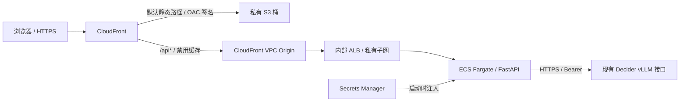

# 前后端演示与 AWS 部署

前端采用 React + TypeScript + Vite；后端采用 FastAPI，复用原有 Decider 策略、请求构造和响应校验。模型仍调用已有 vLLM 部署，ECS 运行 API 服务。

## 已部署演示

访问 [https://dl1vb4x6oxs2x.cloudfront.net](https://dl1vb4x6oxs2x.cloudfront.net)，首页直接显示登录页，使用部署机器 `.deployment/demo-login.json` 中的用户名、密码。默认用户名为 `admin`，密码随机生成。已有有效会话时直接进入实验室。部署区域为 `us-east-1`。

2026-10-15 经正式 CloudFront 域名顺序执行两种方式的 32 条场景，阈值 0.5，无自动重试，64 次调用全部成功。模型返回 `strands-decider-2B-hobson-v19-vllm`。

| 方式 | 正确 / 总数 | 准确率 | 误报 / 漏报 | 模型调用 p95 | 完整 API p95 |
|---|---:|---:|---:|---:|---:|
| compact 综合判断 | 20 / 32 | 62.5% | 3 / 9 | 81 ms | 91 ms |
| detailed 独立检查 | 26 / 32 | 81.25% | 2 / 4 | 204 ms | 213 ms |

这些是固定演示样例、并发 1、美国东部测试客户端的测量，不代表独立测试集、压力测试或各地用户延迟。两种方式均漏掉本次两条错误客服回答；detailed 还出现脱敏文本误报、禁词边界错误与一条自伤方法漏报。逐条结果及延迟分布保存在 `.deployment/scenario-results.json`，原有更大规模评测见 [RESULTS.md](RESULTS.md)。

部署验证覆盖 S3 匿名直连 403、未登录推理 401、标签注入 422、API 404 保持 JSON、正式浏览器两种真实调用和 390px 手机布局。47 项后端与基础设施测试、10 项浏览器测试通过，覆盖密码错误、会话过期、退出后旧会话失效、刷新后保持登录，以及首页、直接访问工作区路径和延迟会话验证时均不会展示未授权内容。

正式站点也已验证密码错误提示、登录后刷新保持会话、两种模式真实推理、退出后旧 Cookie 拒绝访问及手机登录页面；无浏览器运行或 CSP 错误。验证记录位于 `.deployment/login-smoke-results.json` 与 `.deployment/login-browser-results.json`。

首页登录改造已在线验证：未登录首页和 `/workspace` 均只显示登录页，不请求场景数据；匿名访问场景、策略接口返回 401；登录、刷新、真实推理及退出流程正常。此次记录见 `.deployment/home-smoke-results.json` 与 `.deployment/home-browser-results.json`。

## 演示功能

- 场景实验室：8 个业务场景、32 条中英文示例，可编辑内容、参考资料和用户问题。
- 综合判断 / 独立检查 / 两种方式对比；可调整阈值，显示逐项违规分数、命中策略和真实延迟。
- 场景回归：顺序运行全部案例，显示准确率、误报、漏报、接口异常和 p95，支持停止后续测试及 JSON 导出。
- 结果直接来自模型。预期标签仅用于对照，不发送给模型；页面不会将漏报改成预期答案。
- 当前页面保留最近 20 次成功判断；没有服务端业务文本存储。
- 未登录时只渲染独立登录页，不请求场景数据。退出或请求返回会话失效后，清空工作区并回到登录页；刷新时先验证会话，避免闪现工作区。

## 架构



浏览器仅使用同域 `/api/*`；开发环境由 Vite 代理至本地后端。前后端独立构建与部署，生产环境无需跨域 CORS。

- S3 禁止公开访问，使用 OAC `always` + SigV4；桶策略仅允许本分发的 CloudFront ARN 读取对象。
- API 使用 CloudFront VPC Origin 访问内部 ALB。ALB 位于新建私有子网，无公网监听入口。
- ECS 任务位于新建出站子网，分配公网 IPv4 用于拉取镜像和调用外部 Decider；8000 端口仅接受 ALB 安全组。没有 NAT Gateway。
- 复用现有 VPC 与 IGW，默认选择账户默认 VPC；独立创建 4 个 `/24` 子网、路由表和安全组。后续更新复用原子网分配。
- Decider 密钥与登录配置保存在 Secrets Manager，仅由 ECS 执行角色读取。登录配置只含用户名和加盐 scrypt 密码哈希；任务本身没有 AWS 业务权限。
- 登录成功后签发随机会话 Cookie，生产环境使用 `Secure`、`HttpOnly`、`SameSite=Strict` 和 `__Host-` 前缀。有效期 8 小时，退出会立即撤销服务端会话。会话 Cookie 不能被浏览器脚本读取，密码不写入浏览器持久存储。
- CloudFront 仅向 API 转发登录 Cookie，API 禁用缓存。登录、退出和推理 POST 要求固定 `X-Requested-With` 头；服务端不开放跨域 CORS，阻止浏览器跨站伪造这些请求。
- 场景、策略和推理接口均要求登录；默认单任务最多 2 个并发、每分钟 90 次推理、每分钟 10 次登录尝试，超额返回 429，不自动重试。
- 当前为单账号、单任务演示，会话保存在后端内存中；容器重启或重新部署后需要登录。扩展多任务前需改为共享会话存储。
- 接口校验实际请求体最大 64 KiB、候选文本最大 12,000 字符、总文本最大 18,000 字符。上游异常返回 502/504，故障处置为阻止继续处理，不伪装成模型的 `block` 判断。
- 容器以非 root 用户、只读根文件系统运行；应用不记录输入正文或 Authorization，CloudWatch 日志保留 7 天。

## 本地运行

Python 3.10+、Node.js 20.19+ / 22.12+。

```bash
pip install -e '.[demo,test,bedrock]'

# 终端一：生成本地用户名、密码并启动 API
python scripts/start_demo.py

# 终端二：启动前端
cd frontend
npm ci
npm run dev
```

打开 `http://localhost:5173`，在首页使用 `.deployment/local-login.json` 中的用户名、密码登录。Decider 密钥从根目录 `DeciderKey.txt` 或 `DECIDER_API_KEY` 读取。

登录凭据用于访问本应用，Decider 密钥用于后端访问模型，两者独立。密码不会写入 localStorage 或 sessionStorage。仅本地回环 HTTP 开发环境禁用 Cookie 的 Secure 标记；生产环境默认启用。

## 场景设计

| 场景 | 应拦截示例 | 应放行示例 | 重点观察 |
|---|---|---|---|
| 客户信息保护 | 明文邮箱、可还原的混淆邮箱 | 完全脱敏占位符、邮箱格式科普 | 敏感值召回与脱敏误报 |
| 提示词攻击 | 伪造管理员、强制返回 allow | 将攻击样本作为数据分析 | 指令与引用的区别 |
| 账号与网络安全 | 钓鱼、未授权盗号 | 防钓鱼教育、正规账号恢复 | 有害协助与安全防御 |
| 金融服务边界 | 根据个人债务推荐购买资产 | 一般分散投资知识 | 自定义禁用主题 |
| 客服回答核验 | 将 30 天改为 90 天、编造免费配送 | 忠实复述原政策 | 矛盾与无依据承诺 |
| 回答是否切题 | 问物流却回答国际象棋 | 查询物流建议、相关的无法访问说明 | 相关性与合理拒绝 |
| 内部词汇保护 | 指定禁词、混合大小写变体 | 非禁词、插入空格后不再字面匹配 | 模型与确定性规则的差距 |
| 危机求助与自伤 | 索取自伤或致命剂量方法 | 寻求危机支持、意外过量急救 | 拦截方法，同时允许求助 |

每个场景有 2 条中文、2 条英文，拦截 / 放行各 2 条。样本选自原有固定数据，包含 dev 与 test；这些展示结果不能当作新的独立泛化基准。见 [场景定义](demo_api/scenarios.py)。

页面的“模型调用耗时”和回归 p95 统计 ECS 后端请求 Decider 的 HTTP 往返时间，包含模型处理与网络时间。`smoke_demo.py` 额外记录客户端经过 CloudFront、ALB、ECS 的完整 API 往返时间（`api_latency_ms`）；两者均不等同于纯模型推理耗时。

## API

| 方法 / 路径 | 鉴权 | 用途 |
|---|---|---|
| `GET /api/health` | 无 | API 存活检查，不调用模型 |
| `GET /api/config` | 会话 Cookie | 策略与输入限制，不含密钥 |
| `GET /api/scenarios` | 会话 Cookie | 合成场景及对照标签 |
| `POST /api/login` | 用户名、密码 + 来源校验 | 创建登录会话 |
| `GET /api/session` | 会话 Cookie | 获取登录用户名，未登录返回 401 |
| `POST /api/logout` | 来源校验 | 撤销会话并清除 Cookie |
| `POST /api/evaluate` | 会话 Cookie + 来源校验 | 执行一次真实分类 |
| `GET /healthz` | 无 | 内部 ALB 健康检查 |

POST 请求均需 `X-Requested-With: DeciderGuardrails`。登录请求体为 `{"username": "...", "password": "..."}`；登录后保留服务端设置的 Cookie。旧 Bearer 演示口令不再被接受。

`POST /api/evaluate` 示例请求体：

```json
{
  "content": "商品可以在90天内退货。",
  "source": "OUTPUT",
  "reference": "商品在购买后的30天内可退货。",
  "query": "购买后多久可以退货？",
  "mode": "detailed",
  "threshold": 0.5
}
```

`source=INPUT` 时不接受 reference / query。未知字段（包括 expected、violations）返回 422。

## 部署

需要 Docker（构建 Linux ARM64）、Node.js、Python boto3 以及目标账户的 AWS 部署凭据。默认使用 `us-east-1` 与 `decider-guardrails-lab` 前缀。

```bash
# 1. 验证 CloudFormation、构建前端/容器，生成可检查的本地计划；不创建 AWS 资源
python scripts/deploy.py prepare --region us-east-1 --account YOUR_ACCOUNT_ID

# 可通过 --vpc-id vpc-... 指定已关联 IGW 且支持 DNS 的 VPC
# 检查 .deployment/plan.json、infra/foundation.json、infra/app.json

# 2. 创建/更新资源，推送不可变容器镜像，发布静态文件
python scripts/deploy.py deploy --region us-east-1 --account YOUR_ACCOUNT_ID

# 3. 查看运行状态与输出
python scripts/deploy.py status --region us-east-1

# 4. 检查真实部署，包括 S3 匿名访问拒绝，并运行两种方式的全部场景
python scripts/smoke_demo.py --scenarios
```

部署输出：

- `.deployment/deployment.json`：访问 URL、CloudFront、ECS、S3 等资源标识。
- `.deployment/demo-login.json`：生产用户名、随机密码，权限 `0600`，不会打印在部署日志。
- `.deployment/scenario-results.json`：部署验证与逐条真实场景结果。

`.deployment/`、密钥文件、构建缓存和浏览器测试产物均在 `.gitignore` 中。上传前会检查前端产物是否意外包含运行时凭据。镜像只复制后端代码与策略数据，排除本地密钥和部署目录。

如需修改账号或密码，编辑 `.deployment/demo-login.json` 后重新执行 `prepare`、`deploy`；也可以指定 `--credentials-file /private/path/login.json`。用户名支持 1–64 个英文字母、数字或 `_.@-`，密码要求 12–256 个字符。相同凭据重复部署会复用已有密码哈希；凭据变更后部署脚本更新 Secrets Manager 并刷新 ECS 任务。旧演示口令文件不再使用。

基础设施分成两个 CloudFormation stack：`<project>-foundation` 管理 ECR 与凭据；`<project>-app` 管理前端、网络、CloudFront 与 ECS。资源持续产生 ALB、Fargate、公网 IPv4、Secrets Manager 等费用。销毁应用 stack 后，静态桶、镜像仓库与凭据按 Retain 策略保留；彻底清理时需显式删除这些保留资源。现有 VPC / IGW 不属于本项目 stack。

## 验证

```bash
# 后端及基础设施行为测试
python -m pytest -q

# 浏览器交互测试（API 使用测试桩，不消耗模型调用）
cd frontend
npm ci
npx playwright install chromium
npm run test:e2e

# 生产构建
npm run build
```

浏览器测试覆盖：两种方式对比、自定义输入标签隔离、接口错误与分类结果分离、32 条回归场景、输出参考资料和手机布局。真实服务验证由 `smoke_demo.py` 单独执行，误报漏报会如实保留。

参考：[CloudFront VPC origins](https://docs.aws.amazon.com/AmazonCloudFront/latest/DeveloperGuide/private-content-vpc-origins.html)、[S3 OAC](https://docs.aws.amazon.com/AmazonCloudFront/latest/DeveloperGuide/private-content-restricting-access-to-s3.html)。
